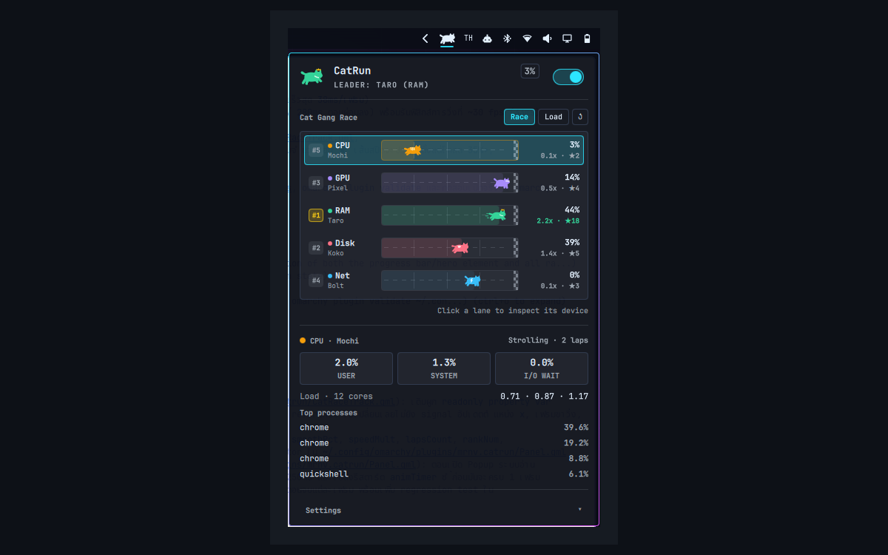

# CatRun

An animated running cat widget for the Omarchy status bar with a live **Cat Gang Race** popup where five distinct cats guard your hardware devices and race in real time according to live resource usage.



## Features

- **Live Bar Companion**: A vector running cat in the Omarchy bar whose stride cadence speeds up with live CPU load (and optionally displays the CPU percentage or naps below a configurable threshold).
- **Cat Gang Device Race (`Race` & `Load` modes)**: Click the bar icon to open a 5-lane real-time race where each cat guards a device:
  - **CPU · Mochi** — Ginger tabby (`/proc/stat`)
  - **GPU · Pixel** — Cyber-visor cat (`/sys/class/drm/card*/device/gpu_busy_percent` and `nvidia-smi` only when an NVIDIA GPU is already active, avoiding dGPU wakeups on battery)
  - **RAM · Taro** — Mint tuxedo (`/proc/meminfo`)
  - **Disk · Koko** — Coral calico (`/proc/diskstats` physical block devices)
  - **Net · Bolt** — Sky lightning (`/proc/net/dev` non-loopback interfaces)
- **Real-time Speed Scaling**: While the popup is open, `/proc` sensors poll at 4 Hz with zero subprocesses and smooth acceleration/deceleration so resource bursts visibly launch cats ahead (with speed streaks and a golden crown for the `#1` leader). When closed, race physics stop completely to keep idle overhead minimal.
- **Interactive Device Inspector**: Click any lane (or press `1`–`5`) to inspect live breakdowns (CPU load & top processes, GPU model/VRAM/temp, RAM used/available/cached, Disk read/write rates, Network down/up & active interface).
- **Live Translations**: Includes English (`en`) and Thai (`th`) catalogs that follow Omarchy's language setting live without restarting the shell.
- **Keyboard & IPC Support**:
  - Popup shortcuts: `Space` (pause/resume), `m` (toggle Race/Load mode), `0` (reset laps), `1`–`5` (inspect device), `p` (toggle bar %), `r` (flip direction), `b` (open `btop`).
  - IPC commands via `omarchy-shell mrnv.catrun <method>`: `open`, `close`, `toggle`, `pause`, `resume`, `togglePause`, `togglePercent`, `setSize <px>`, `setRaceMode <race|load>`, `resetRace`, `selectDevice <cpu|gpu|ram|disk|net>`, `state`.

## Installation

Install and enable with Omarchy's built-in plugin CLI:

```bash
omarchy plugin add https://github.com/VivatVibe/omarchy-catrun --enable
```

## Removal

Remove the plugin cleanly with Omarchy's built-in plugin CLI:

```bash
omarchy plugin remove mrnv.catrun
```

## Configuration

Settings can be adjusted directly inside the CatRun popup's **Settings** section (or in `~/.config/omarchy/shell.json` under the `mrnv.catrun` widget entry):

| Key | Type | Default | Description |
| --- | --- | --- | --- |
| `catSize` | integer (`8`–`24`) | `16` | Bar cat icon height in pixels |
| `showPercent` | boolean | `false` | Show live CPU percentage beside the bar cat |
| `sleepThreshold` | integer (`0`–`30`) | `0` | Usage percentage below which cats nap (`0` disables napping) |
| `invertDirection` | boolean | `false` | Mirror the bar cat to run left |
| `raceMode` | `"race"` \| `"load"` | `"race"` | Continuous lap race or direct usage-percentage positioning |

## Dependencies & Permissions

- **Runtime**: Omarchy Quattro (`omarchy-shell` / Quickshell).
- **Data sources**: Local kernel files (`/proc/stat`, `/proc/loadavg`, `/proc/meminfo`, `/proc/diskstats`, `/proc/net/dev`, `/sys/class/drm/*/device/gpu_busy_percent`), `ps` for top processes while the popup is open, optional `nvidia-smi` when an NVIDIA GPU is active, and optional `btop` when clicking **Open Activity Monitor**.
- **Privacy & Security**: No network requests, no background daemons, no elevated root privileges, and no modifications to user configuration outside the plugin's own inline bar entry when you change a setting.

## Testing & Validation

```bash
node tests/model.test.mjs
omarchy plugin validate .
```

## License

[MIT](LICENSE)
